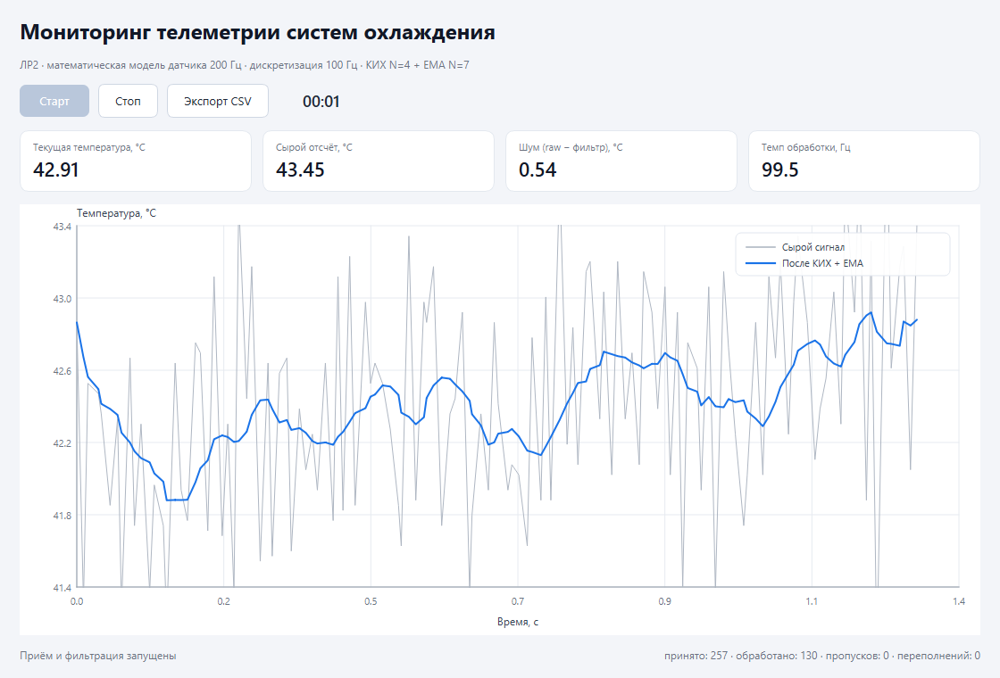

# Qt GUI

В репозитории есть два исполняемых приложения:

- `ctm_acq` — консольный прогон и `--verify`, без Qt;
- `cooling_telemetry_gui` — Qt Widgets-интерфейс: график, текущие значения, старт/стоп,
  экспорт CSV.

Оба используют одно и то же ядро `ctm_core`, поэтому результаты фильтрации одинаковы.



## 1. Что показывает окно

- **Старт / Стоп** — запускает и останавливает `AcquisitionPipeline` в фоновом потоке.
- **Текущая температура** — последнее отфильтрованное значение.
- **Сырой отсчёт** — последнее значение до фильтрации.
- **Шум (raw − фильтр)** — насколько фильтр отклонился от сырого сигнала.
- **Темп обработки** — фактическая частота обновления, около 100 Гц.
- **График** — серая линия «сырой сигнал», синяя — после КИХ + EMA.
- **Статус** — принято / обработано / пропусков / переполнений.
- **Экспорт CSV** — сохраняет накопленные точки в `time_s,raw,filtered,seq`.

## 2. Как устроено

```
MainWindow (GUI-поток)
   │  start/stop
   ▼
AcquisitionPipeline (поток источника + поток обработки)
   │  Sink(FilteredSample)
   ▼
QMetaObject::invokeMethod(..., Qt::QueuedConnection)
   │
   ▼
MainWindow::onSample -> deque<FilteredSample>
   │  QTimer 100 мс
   ▼
TelemetryPlot::setSamples -> paintEvent
```

Ключевой момент: `Sink` вызывается **не в GUI-потоке**, а в потоке обработки.
Поэтому напрямую трогать виджеты нельзя. `MainWindow` перебрасывает отсчёт в
GUI-поток через `QMetaObject::invokeMethod` с `Qt::QueuedConnection`. Это
стандартный и безопасный способ, без `QThread::msleep` и без гонок.

`TelemetryPlot` — обычный `QWidget` с `paintEvent`. QtCharts не нужен: две линии,
сетка и подписи рисуются `QPainter` за несколько миллисекунд.

## 3. Сборка

### Вариант A: готовый скрипт (проверен)

```powershell
cd gui
./build_gui.ps1
./release/cooling_telemetry_gui.exe
```

Скрипт:

1. вызывает `moc` для `mainwindow.h` и `telemetryplot.h`;
2. компилирует GUI и ядро Qt-компилятором из `C:\Qt\Tools\mingw1310_64`;
3. линкует `Qt6Widgets`, `Qt6Gui`, `Qt6Core`, `Qt6EntryPoint`, `winmm`;
4. копирует Qt DLL и платформенные плагины в `release/`.

Если Qt установлен в другое место:

```powershell
$env:QT_ROOT = "D:\Qt\6.8.0\mingw_64"
$env:QT_MINGW = "D:\Qt\Tools\mingw1310_64"
./build_gui.ps1
```

### Вариант B: CMake

Из корня репозитория:

```bash
cmake -S . -B build -DCMAKE_PREFIX_PATH="C:/Qt/6.11.1/mingw_64"
cmake --build build --config Release
```

GUI-цель появится, только если CMake нашёл `Qt6::Widgets`. Иначе ядро и CLI
соберутся без GUI, а в лог будет `Qt6 Widgets not found: GUI target skipped`.

### Вариант C: Qt Creator

1. Открыть `gui/gui.pro` или `gui/CMakeLists.txt`.
2. Выбрать kit **Qt 6.11.1 MinGW 64-bit**.
3. Собрать и запустить.

Для переносимой папки после сборки:

```bash
windeployqt --no-translations --no-opengl-sw release/cooling_telemetry_gui.exe
```

## 4. Режимы для проверки

```bash
# 2 секунды, старт/стоп, выход с кодом 0
cooling_telemetry_gui.exe --smoke-test -platform windows

# запустить приём, через 1,5 с сохранить окно в PNG и выйти
cooling_telemetry_gui.exe --screenshot docs/gui-preview.png -platform windows
```

`--smoke-test` удобен для CI: он проверяет, что окно создаётся, конвейер
запускается и останавливается без зависаний.

## 5. Файлы

| Файл | Назначение |
|---|---|
| `main.cpp` | `QApplication`, режимы `--smoke-test` и `--screenshot` |
| `mainwindow.h/.cpp` | окно, карточки, старт/стоп, CSV, marshalling в GUI-поток |
| `telemetryplot.h/.cpp` | график на `QPainter` |
| `gui.pro` | сборка через qmake |
| `CMakeLists.txt` | сборка через CMake |
| `build_gui.ps1` | сборка без qmake/CMake, с копированием Qt DLL |

## 6. Ограничения

- GUI не содержит вкладок БД и настроек — это ЛР4.
- График хранит последние 12 000 отсчётов (около 2 минут при 100 Гц), чтобы
  память не росла бесконечно.
- `QMetaObject::invokeMethod` с `QueuedConnection` требует, чтобы `MainWindow`
  жил дольше конвейера. Деструктор останавливает `pipeline_`, поэтому очередь
  не получит события после разрушения окна.
- Для production нужно добавить `windeployqt`, установщик и проверку версии Qt.
